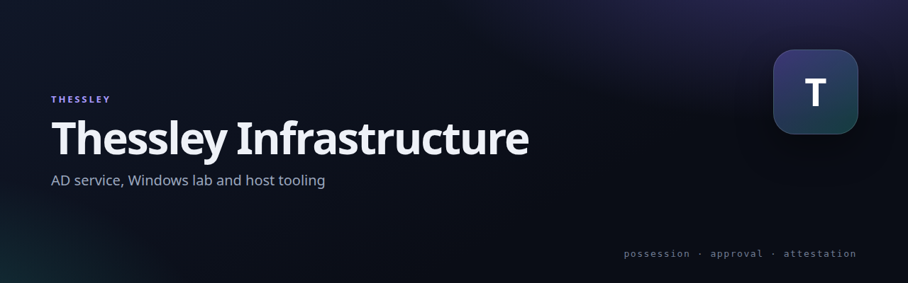

# Thessley Infrastructure

 

Lab and service infrastructure behind the Thessley projects.

## Layout

| Path | What it is |
|---|---|
| `thessley_ad_service/` | Active Directory side: phone-key registry, admin web console, logon-key enrolment, DC pairing. |
| `windows-ad-lab/` | The Windows/AD lab: domain notes, credential-provider prototype, certificate pilot, SSH gate. |
| `thessley_passkey/` | Shared server pieces used by the lab service. |
| `unwantedip_api/` | The small API the reputation tracker exposes to the hardening plugin. |
| `crawler-nets-updater.php` | Keeps the crawler network list current on the WordPress hosts. |

## Credentials

Lab credentials are **not** in this repository. `windows-ad-lab/LOCAL-CREDENTIALS.txt` is ignored and stays on the machines that need it. Nothing here phones home.

## Related

- [Thessley](https://github.com/netmate1234/Thessley) — overview and the other projects

## License

GPL-2.0-or-later.
